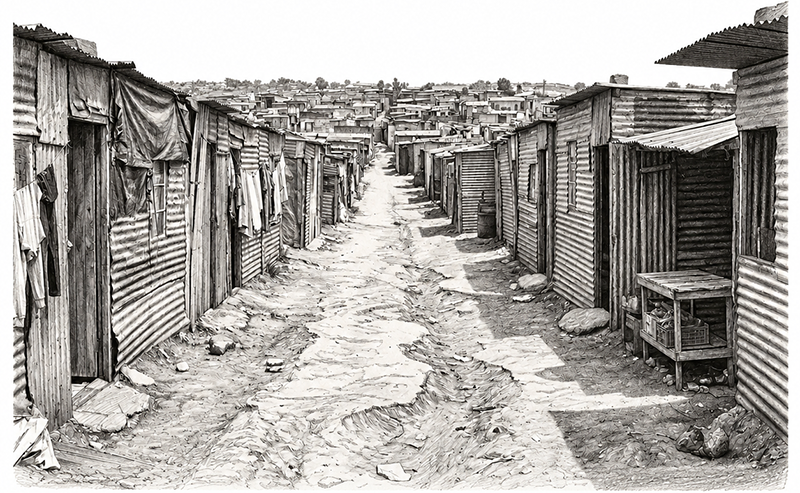

# 세상이 바뀌었다. 그런데 삶도 바뀌었을까?

1994년 남아프리카공화국. 국가는 아파르트헤이트 이후의 새로운 체제로 넘어가고 첫 민주선거를 맞습니다. 수많은 사람이 새로운 시대를 기대하지만, 대학생 은조마네의 일상은 그렇게 단순하게 달라지지 않습니다. 등록금은 부족하고, 장학금은 절실하며, 가족의 형편은 어렵습니다. 대학에서는 수업과 시험이 기다리고, 거리에는 여전히 가난과 불평등이 남아 있습니다.

그렇다고 은조마네가 비장하게 현실과 싸우는 인물인 것은 아닙니다. 그는 수업을 빼먹고, 파티를 즐기고, 필요하면 거짓말도 하고, 때로는 뻔뻔할 정도로 자기 살길을 찾아갑니다.

'은조마네의 구구도생'은 바로 그런 청년의 눈으로 새로운 시대의 희망과 일상에 남아 있는 오래된 문제를 바라보는 소설입니다.

# 왜 '구구도생'인가?

한국어판 제목에서 사용한 ‘구구도생’은 작품을 위해 만든 조어입니다. 

구구도생 狗苟圖生
구차해지더라도 어떻게든 살아남기를 도모하다.

원제 Dog Eat Dog가 약육강식의 세계를 보여 준다면, 한국어판 제목은 그 세계 속에서 은조마네가 살아가는 방식에 초점을 맞춥니다.

# 성실하진 않았지만 살아남았습니다.

미국 Ohio University Press는 이 작품을 1994년 남아공의 체제 전환기에 존재했던 희망과 깊은 실망을 함께 포착하면서, 소웨토와 콰이토 세대의 삶을 보여 주는 작품으로 소개하고 있습니다. 작품은 대학생 은조마네의 대학생활과 경제적 곤란을 첫 민주선거라는 역사적 배경 속에 배치합니다.

은조마네는 영리하고 능청스럽고 때로는 염치없습니다. 하지만 바로 그 모습 때문에 이 소설의 사회적 현실은 더 생생해집니다. 우리는 이 작품을 통해 역사가 바뀐 다음 날에도 계속 살아가야 했던 평범한 청년의 삶을 한국 독자에게 소개하고자 합니다.

# 그들이 이해하는 건 거짓말뿐이야

작품 속에는 모순된 현실을 정면으로 꿰뚫는 서늘한 대사가 등장합니다.

> “이 나라에서 백인들이 이해하는 유일한 언어가 거짓말이라는 걸 알아야 해. 음팔렐레 교수가 쓴 《아프리카 마이 뮤직》이라는 책 읽어봤니? 내가 지금 하는 말 그대로 써놨어. 이 나라에서 살아남으려면 백인들에게 거짓말을 해야 한다고. 왜냐하면 백인들 자신도 이미 거대한 거짓말의 거미줄 속에서 살고 있으니까. 그들이 이해하는 건 거짓말뿐이야.”

거대한 거짓말의 구조 속에서 살아남기 위해 또 다른 거짓말과 임기응변으로 맞서는 주인공 은조마네의 분투를 보며, 비로소 ‘구구도생(구차하고 비루하게라도 기어이 목숨을 부지하며 살아남다)’이라는 네 글자가 떠오릅니다.

무엇보다 은조마네는 그 비루한 현실 앞에서도 결코 유쾌함과 삶의 의지를 잃지 않습니다. 온갖 궁지에 몰린 순간에도 그는 이렇게 되뇌입니다.

> “내게 필요한 건 그런 말 한마디였다. 포기하지 않을 거다.”

비루하게 구르되 결코 꺾이지 않는 이 태도야말로, 지구 반대편 남아프리카공화국의 이야기를 넘어 지금 대한민국의 녹록지 않은 현실을 살아내는 우리 시대 청년들과 깊숙이 공명할 수 있는 진짜 지점입니다.

# Dog Eat Dog

아프리카 현대문학의 독창적인 목소리, 닉 믈롱고의 장편 데뷔작 국내 첫 소개

2006년 스페인 ‘라 마르 데 레트라스(La Mar de Letras)’ 문학상 수상작
미국 오하이오대학교 출판부 ‘Modern African Writing’ 시리즈 선정
닉 믈롱고는 아파르트헤이트 이후 남아공 문단에서 가장 활기 넘치고 당돌한 신진 목소리 가운데 하나다. – 『뉴욕 타임스』(The New York Times)
믈롱고가 신선하게 풀어낸 이 소설은 결코 포기하지 않기로 마음먹은 한 젊은이의 이야기다.
– 『북리스트』(Booklist)
콰이토 음악이 크게 울려 퍼지고, 온갖 아프리카 언어가 허공을 떠다니며, 희망과 실망이 독처럼 뒤섞여 모든 것을 잠식하는 오늘날의 소웨토와 요하네스버그를 거침없이 누비는 이야기. – 『워즈 위드아웃 보더스』(Words Without Borders)

# 저자 소개

Niq Mhlongo

남아프리카공화국의 소설가이자 라디오·텔레비전 극작가, 여행 작가다. 《Dog Eat Dog》(2004)과 《After Tears》(2007)는 평단의 호평을 받으며 여러 문학상을 받거나 최종 후보에 올랐고, 아프리카 현대문학을 영어권 독자에게 소개하는 미국 오하이오대학교 출판부의 ‘Modern African Writing’ 시리즈로 출간되었다. 현재 독일 베를린에 거주하며 창작과 강연을 이어가고, 유럽과 남아프리카공화국의 국제 문학 행사에 참여하고 있다.

# 번역해 주신 분

옮긴이 윤승희
연세대학교 노어노문학과를 졸업하고 한국외국어대학교 통번역대학원 한노과 및 한영과를 졸업한 뒤 전문번역가로 활동 중이다. 옮긴 책으로는 《세계 100대 작품으로 만나는 현대미술 강의》, 《1389번 귀 인식표를 단 암소》, 《기억의 뇌과학》, 《왬! 라스트 크리스마스(공역)》, 《생각하라 그리고 부자가 되어라》, 《금지된 기억: 문화대혁명 시기의 티베트》 등이 있다.

# 도서 정보

예상분량: 304페이지
판형: 46판, 128x188 (mm)
제본: 각양장
예상정가: 18,000원

